

# MG Component Tester

### Arduino Nano ATmega328P Component Measurement System

**Author:** Mohamed Gamal (MG Engineer) · [Website](https://sites.google.com/view/mgengineer) · [GitHub](https://github.com/MohamedGamal045)

> [!WARNING]
> **Bench equipment only.** Test only unpowered and safely discharged components. The source firmware detects live voltage as a fault condition, but this system is not a certified isolation or safety instrument. No accuracy or compliance claim is validated until independent measurement and bench testing are completed.

---

## Project at a Glance

<table>
  <tr>
    <td align="center"><b>Three-lead measurement</b> 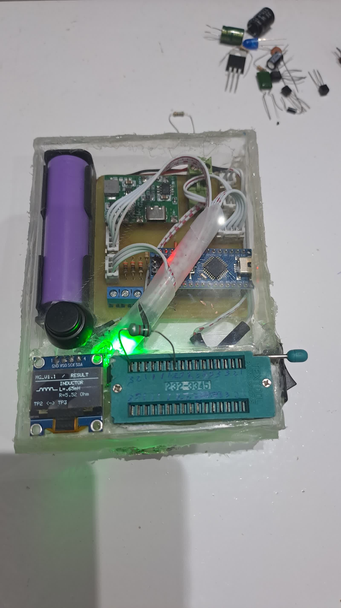 TP1–TP3 component fixture</td>
    <td align="center"><b>OLED interface</b>  I2C SSD1306 display and controller</td>
    <td align="center"><b>Custom PCB</b>  Proteus PCB V1.2 design</td>
  </tr>
</table>

The MG Component Tester is a custom graphical interface and hardware integration built around a component-measuring ATmega328P firmware engine. It measures components through a three-probe resistance-network and presents classified results on a 128×64 OLED with RGB status indication.

## Live Demonstrations

<table>
  <tr>
    <td align="center"><b>Test 01</b> 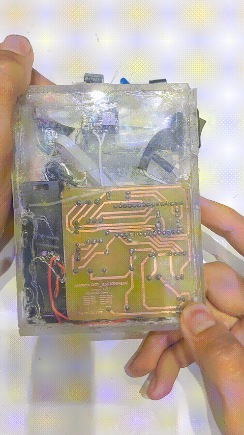</td>
    <td align="center"><b>Test 02</b> 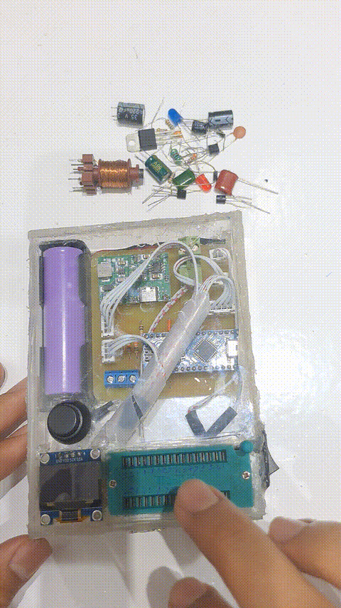</td>
    <td align="center"><b>Test 03</b> 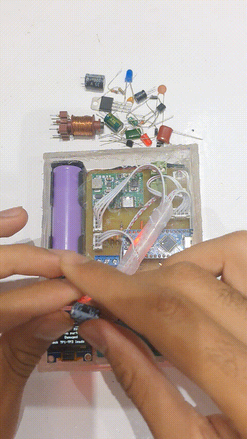</td>
  </tr>
  <tr>
    <td align="center"><b>Test 04</b> 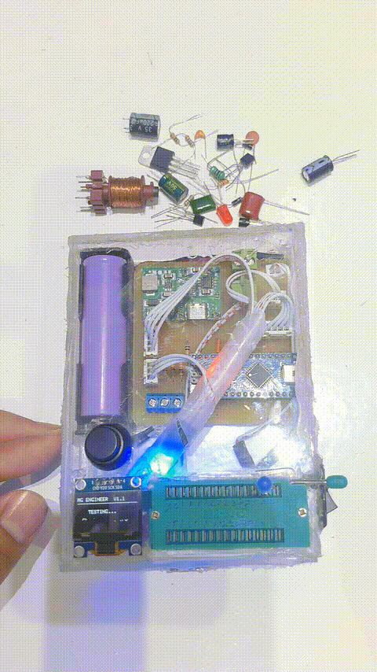</td>
    <td align="center"><b>Test 05</b> 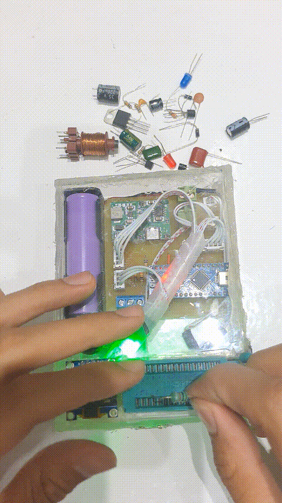</td>
    <td align="center"><b>Test 06</b> 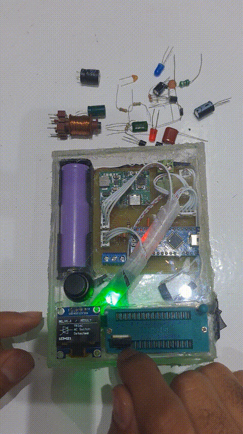</td>
  </tr>
  <tr>
    <td align="center"><b>Test 07</b> 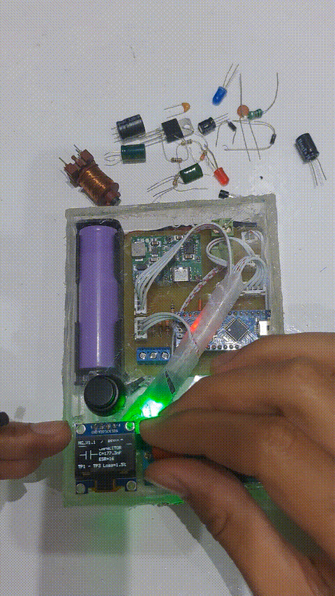</td>
    <td align="center"><b>Test 08</b> 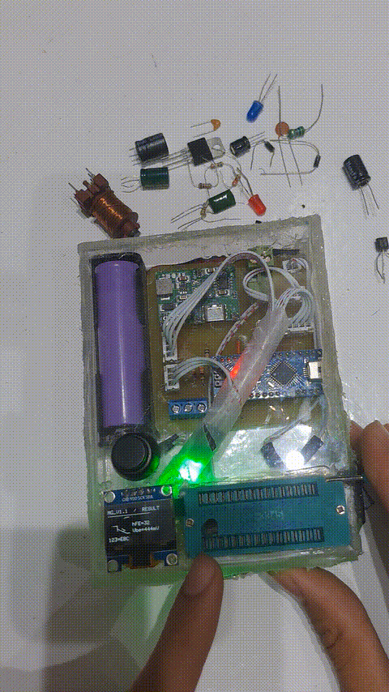</td>
    <td align="center"><b>Test 09</b> 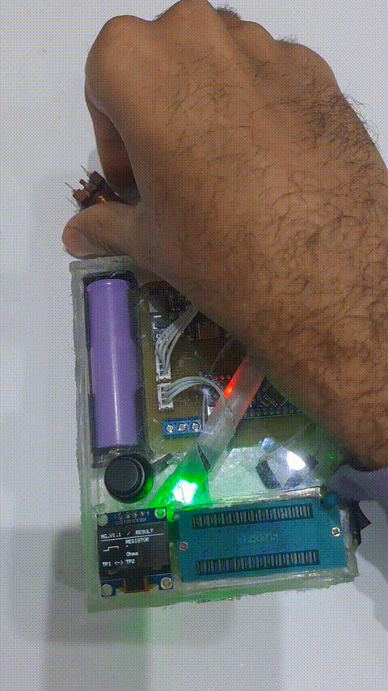</td>
  </tr>
  <tr>
    <td align="center"><b>Test 10</b> 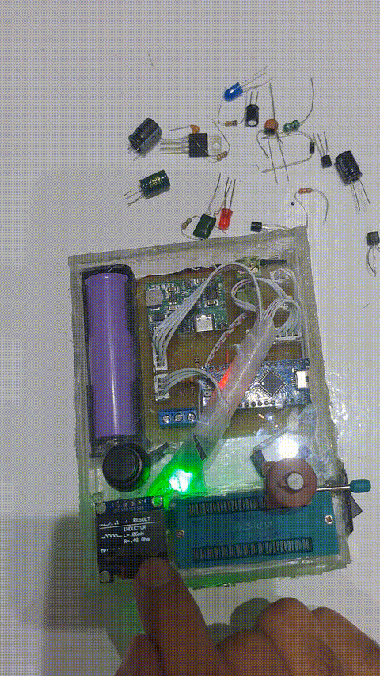</td>
    <td align="center"><b>Prototype handling</b> </td>
    <td align="center"><b>RGB status testing</b> </td>
  </tr>
</table>

These clips cover the supplied component-test footage at 60-second intervals. Individual component names are not labeled here because the video and workspace do not contain enough on-screen or catalog evidence to identify every part without guessing. The clips demonstrate operation and RGB state changes; they do not constitute calibration or accuracy validation.

## System Architecture

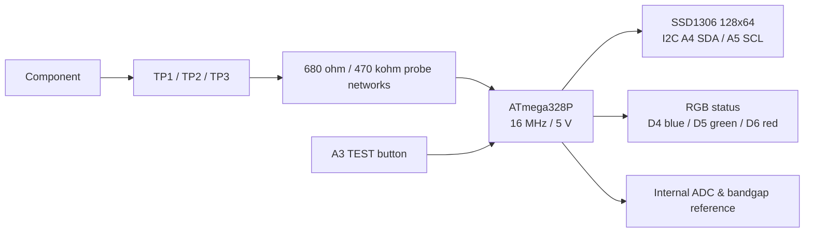

The measurement engine identifies resistors, capacitors, inductors, diodes, LEDs, BJTs, MOSFET/JFET devices, TRIACs and thyristors. Detection is implemented in the source; numeric accuracy depends on PCB component tolerance and calibration.

## Verified Hardware

| Item | Verified implementation |
|---|---|
| MCU | Arduino Nano, ATmega328P, 16 MHz, 5 V |
| Display | SSD1306 OLED, 128×64, I2C address `0x3C` |
| Test probes | TP1 = PC0/A0, TP2 = PC1/A1, TP3 = PC2/A2 |
| Probe resistors | Nominal 680 Ω low network and 470 kΩ high network |
| TEST button | D17/A3 in Arduino pin mapping, 10 kΩ pull-up model, active low |
| RGB status | D4 blue, D5 green, D6 red; common-anode configuration enabled |
| OLED SDA/SCL | A4/SDA and A5/SCL |
| UART | Disabled by default; source protects A3–A5 from UART/output configuration |

### Verified Mapping

| Function | AVR/Arduino mapping | Firmware constant |
|---|---|---|
| Probe TP1 | ADC0 / PC0 / A0 | `TP1` |
| Probe TP2 | ADC1 / PC1 / A1 | `TP2` |
| Probe TP3 | ADC2 / PC2 / A2 | `TP3` |
| Precision reference | ADC4 / PC4 / A4–but OLED uses A4 for SDA | `TPREF` (not enabled as an output in OLED build) |
| Battery voltage input | ADC5 / PC5 / A5–but OLED uses A5 for SCL | `TPBAT` (optional source capability) |
| TEST button | Digital pin 17 / A3 | `RST_PIN=17` |
| RGB red/fault | D6 | `MG_LED_RED_PIN=6` |
| RGB green/valid | D5 | `MG_LED_GREEN_PIN=5` |
| RGB blue/testing | D4 | `MG_LED_BLUE_PIN=4` |

> [!NOTE]
> The PCB and source do not provide enough evidence to claim that every low/high probe resistor is at the exact labeled value. The firmware uses 680 Ω and 470 kΩ nominal values scaled in software; PCB validation remains required.

## Firmware

| Attribute | Status |
|---|---|
| Firmware file | [MG_Component_Tester_V1_2.ino](Code/MG_Component_Tester_V1_2/MG_Component_Tester_V1_2.ino) |
| Build target | Arduino Nano / ATmega328P / 16 MHz |
| Display build | OLED I2C enabled by default |
| Language | English |
| UART | Disabled |
| Self-test | Disabled |
| Auto-calibration | Disabled |
| Internal bandgap/auto-reference | Enabled |
| Compilation | **Not verified in this workspace** |
| Upload/testing | **Not verified on physical hardware** |

The source is a modified derivative of “Transistor Tester for Arduino v1.08a”, attributed in the source header to Karl-Heinz Kubbeler v1.08k. Mohamed Gamal’s customization includes the OLED GUI, MG branding, RGB status handling, result graphics and measurement corrections.

### Dependencies

- AVR `Wire.h` for OLED I2C
- Adafruit GFX
- Adafruit SSD1306
- Adafruit BusIO, where required by the local Arduino library installation
- AVR cores and standard AVR headers

No Arduino build manifest or archived dependency license set is included in the workspace. Third-party license terms must be confirmed before redistribution.

## PCB Engineering

| Top | Bottom | Schematic |
|---|---|---|
|  |  |  |

- Active PCB project: [MG_Component_Tester_PCB_V1.2.pdsprj](PCB/MG_Component_Tester_PCB_V1.2.pdsprj)
- PCB workspace: [PCB](PCB/)
- Project backups: [PCB/Project Backups](PCB/Project%20Backups/)

The PCB is designed in Proteus 8-format project files. Gerber, BOM, drill, DRC reports and assembly data are not present in the workspace snapshot.

## Status and Safety Behavior

| State | OLED indication | RGB behavior |
|---|---|---|
| Idle | “Insert component / Press TEST” | Off |
| Testing | “TESTING…” | Blue |
| Valid result | Component type and values | Green |
| Fault/no component/live voltage | Fault message or no-part state | Red |

The red state is used for no component, component-cell state, dead short, excessive capacitor loss/ESR, or rejected transistor junction values according to current firmware thresholds. It is a firmware heuristic, not an automated insulation or high-voltage safety certification.

## Validation Status

### Verified

- Source code and custom OLED/RGB implementation
- ATmega328P mapping and probe constants
- SSD1306 I2C address
- Proteus PCB project and captured top/bottom/schematic images
- Supplied prototype and video demonstrations

### Not verified

- Firmware compile/link result
- Flash and SRAM usage
- Upload success
- Actual PCB resistor values
- OLED module pin compatibility
- RGB LED color wiring versus common-anode setting
- Measurement accuracy and calibration
- Bench safety behavior
- Fabrication or certification status

## Documentation

- [System Architecture](docs/system-architecture.md)
- [Hardware Documentation](docs/hardware-documentation.md)
- [Firmware Documentation](docs/firmware-documentation.md)
- [Communication and Interfaces](docs/communication-overview.md)
- [Testing and Validation](docs/testing-and-validation.md)
- [Arabic Firmware Notes](Code/MG_Component_Tester_V1_2/README_AR.md)
- [Firmware Changelog](CHANGELOG.md)

## Repository Concerns

- No root LICENSE file; the original-measurement-engine derivative needs a source-compatible license review.
- No Arduino build manifest or dependency manifest.
- No exported fabrication files or BOM.
- The existing Arabic README reports an earlier V1.0 build-name and build-size issue; it may not describe the current V1.1/V1.2 naming consistently.
- The workspace contains root-level screenshot and media files, while organized copies now exist under `media/`.

## Project Information

- **Project:** MG Component Tester
- **Version in firmware:** MG_V1.1
- **PCB project:** V1.2
- **Owner:** Mohamed Gamal
- **Platform:** Arduino Nano / ATmega328P

Built and documented as an engineering prototype — verify, calibrate and retest before field use.

